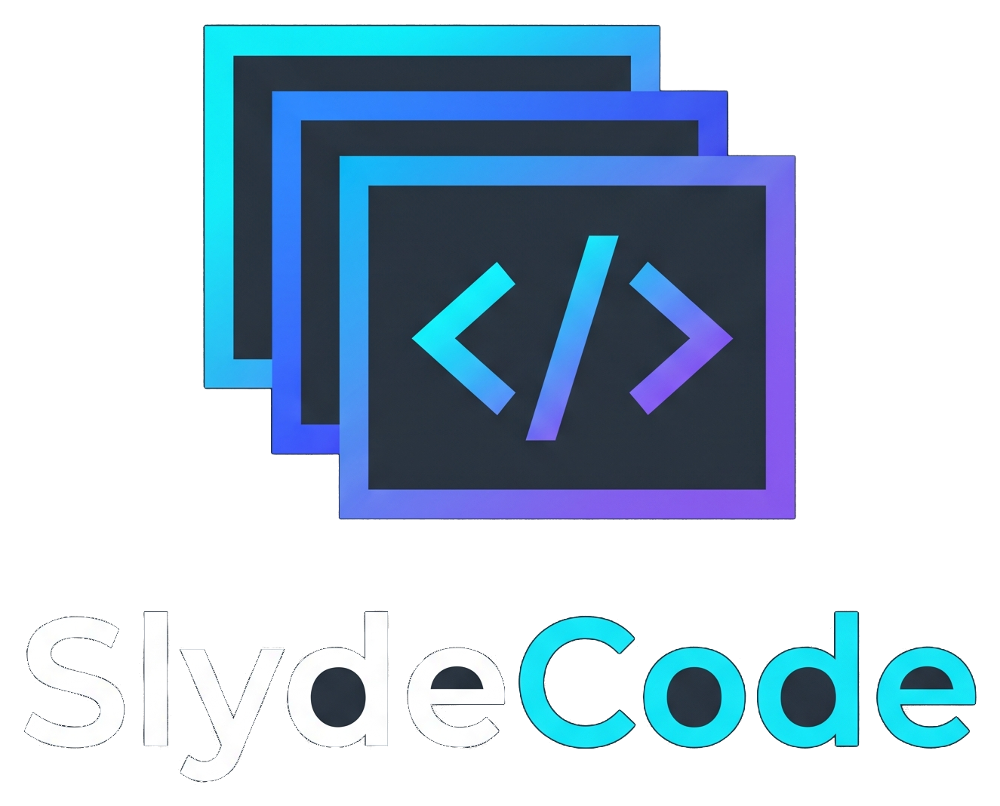

<p align="center">
  
</p>

<p align="center">
  <strong>Canva met a compiler.</strong> An AI-native, editorial-grade presentation studio.<br>
  <em>The high-performance Rust core owns the live deck state and compiles to zero-leak sandboxed HTML slides.</em>
</p>

<p align="center">
  
  
  
  
</p>

---

## Highlights

- **Linear/Figma-tier Studio UI:**
  - **Official Branding:** Clean vector brand identity and high-res transparent emblem.
  - **Deck Quick Tools:** Dedicated topbar tools to create a *New* presentation, *Open* an existing `.slyde` file from disk, and *Save* a copy instantly.
  - **Native Drag-and-Drop Storyboard:** Reorder slides effortlessly with smooth HTML5 drag-and-drop and spatial drop indicators.
  - **Slide Quick Actions:** Duplicate, delete, and shift slides up or down directly from thumbnail hover bars.
  - **Template Picker Popover:** One-click insertion of layout starters: *Hero*, *Bullet List*, *Diagram*, *Data Chart*, *Image Layout*, or *Code Block*.
  - **Subtabbed Inspector (Slide vs. Deck):** Clean separation of slide-specific settings (notes, animation, developer mode) from deck settings (visual theme swatches, ratio, exports) without vertical scroll fatigue.
  - **Visual Theme Swatches:** Instant palette switching (*Studio*, *Paper*, *Night*) with color dot previews.
  - **Canvas Zoom Controls:** Fit to viewport, 50%, 75%, 100%, 125%, 150%.
  - **Real-Time Save Status:** Continuous debounced autosave with a subtle pulsing status indicator.
  - **Dual-Locale Runtime i18n:** Full English and Spanish localization with zero-reload switching (`EN` / `ES`).
  - **Light & Dark Mode:** Warm minimalism with signature violet→coral gradients and AA-contrast compliant typography.

- **In-App AI Copilot with Live Reasoning Streaming:**
  - **8 Authentic Provider Logos:** DeepSeek, OpenAI (ChatGPT), Anthropic (Claude), Google Gemini, xAI (Grok), Groq, OpenRouter, and NVIDIA NIM with official SVG brand marks.
  - **Sub-300ms Live Thinking Stream (`ChatEvent::Thinking`):** Reasoning models like `deepseek-flash` stream their internal thinking process live in a downward collapsible mono drawer with markdown previews.
  - **Direct Upstream Error Transparency:** Never masks errors behind generic alerts; surfaces exact provider feedback and details.
  - **Full Deck Tools Loop:** The copilot autonomously inspects and modifies the deck using structured tools (`read_deck`, `read_slide`, `create_presentation`, `upsert_slide`, `remove_slide`, `move_slide`, `trigger_animation`, `set_notes`).
  - **Contextual Prompt Suggestions:** Instant suggestion pills tailored to the active slide or deck state.
  - **Multimodal File Attachments:** Attach images (PNG, JPEG, WebP), PDFs, DOCX, PPTX, or code/text files with server-side extraction.
  - **Zero-Friction Key Management:** Keys stay on your machine in `%APPDATA%\SlydeCode\copilot.json` (or environment variables) and are never exposed to the browser.

- **Native Motion & Animation Engine:**
  - **Continuous CSS Motion Graphics:** Copilot writes hardware-accelerated CSS `@keyframes` in `<style>` for living graphics (rotating rings, pulsing glowing nodes, radar sweeps, SVG stroke drawings).
  - **Stepped Runtime Entrance Animations:** Built-in keyframes for `fade_up`, `fade`, `scale_in`, `slide_in_left`, `slide_in_right`, `typewriter`, `spin`, `rotate_in`, `pulse`, `flip_up`, `blur_in`, and `bounce_in`.
  - **Zero-Leak Sandbox Isolation:** Slide styles and scripts run within isolated, CSP-hardened iframes (`connect-src 'none'`, `form-action 'none'`).

- **Dual-Screen Presenter & Speaker Console:**
  - **Split Presenter Group:** One-click launch into fullscreen presentation mode or dedicated **Speaker Console** (*Modo Orador*).
  - **Popup Blocker Resilient:** Graceful unblocked navigation fallback ensuring presentation windows launch reliably in Chrome app mode.
  - **Stage Stepper & Blackout Mode:** Press `Space`/`Enter` to step through animation fragments, `B`/`.` for instant blank/blackout screen, `Home`/`End` to jump directly to first/last slide.
  - **Speaker Notes & Clocks:** Real-time wall clock, digital stopwatch timer (Play/Pause/Reset), and scalable notes viewer (`A-` / `A+`).

- **Model Context Protocol (MCP) Server:**
  - Connect external AI coding agents (Claude Desktop, Cursor, Windsurf, etc.) via stdio JSON-RPC 2.0 (`slyde mcp`).
  - Auto-spawns the studio instance if not already running.
  - External agent edits trigger visual scanline sweeps and live activity chips in the studio canvas.

- **High-Fidelity Chrome CLI & In-App Exports:**
  - Vector PDF exports (`--print-to-pdf`) formatted to exact 16:9 (`960×540 pt`).
  - High-res 1280×720 PNG slide images bundled into a clean ZIP download.
  - Bundled variable Geist Sans and Geist Mono typography embedded into exported artifacts.

---

## Requirements

- **Rust:** Stable toolchain (`+stable-x86_64-pc-windows-gnu` recommended on Windows).
- **Browser:** Google Chrome, Chromium, or Microsoft Edge (Chromium-based).
- **Node.js:** Node.js 24+ for running the browser CDP test suite (zero npm dependencies).

---

## Build & Run

### 1. Build the Rust workspace
```powershell
cargo +stable-x86_64-pc-windows-gnu build --workspace
```

### 2. Start the Studio
```powershell
target\debug\slyde.exe app
```
The studio will automatically open in an isolated Google Chrome application window.

---

## Commands Reference

| Command | Purpose |
|---|---|
| `slyde` or `slyde app` | Launch the presentation studio and open Chrome. |
| `slyde app --present` | Launch directly in kiosk presenter mode. |
| `slyde app --no-open` | Start the local server without launching Chrome (prints session URL). |
| `slyde mcp` | Start the stdio MCP server for external agent integration. |
| `slyde export --format pdf --out deck.pdf` | Render and export the active deck as an exact 16:9 PDF. |
| `slyde export --format png --out exports/` | Export each slide as an individual 1280×720 PNG image. |
| `slyde version` | Show version information. |
| `slyde help` | Show command usage. |

---

## Keyboard Shortcuts

| Shortcut | Context | Action |
|---|---|---|
| `ArrowRight` / `ArrowDown` | Studio / Presenter | Next slide |
| `ArrowLeft` / `ArrowUp` | Studio / Presenter | Previous slide |
| `Space` / `Enter` | Presenter | Advance animation step or next slide |
| `B` / `.` | Presenter | Blank / Blackout screen toggle |
| `Home` / `End` | Presenter | Jump directly to first or last slide |
| `S` | Presenter | Toggle Speaker Console Mode (*Modo Orador*) |
| `F` | Presenter | Toggle fullscreen |
| `Escape` | Presenter | Exit kiosk / presenter mode |
| `Ctrl+Z` / `Cmd+Z` | Studio | Undo mutation |
| `Ctrl+Y` / `Cmd+Shift+Z` | Studio | Redo mutation |
| `Drag & Drop` | Storyboard | Reorder slides with visual drop targets |

---

## Environment Variables

| Variable | Description |
|---|---|
| `SLYDE_DATA_DIR` | Custom directory for runtime metadata, decks, Chrome profiles, and copilot keys. |
| `SLYDE_UI_DIR` | Override the directory serving static web UI assets. |
| `SLYDE_ASSETS_DIR` | Override directory for bundled fonts and icons. |
| `SLYDE_BROWSER` | Explicit path to the Google Chrome, Chromium, or Edge executable. |
| `RUST_LOG` | Tracing filter configuration (logs output to stderr; stdout reserved for MCP). |

### Provider API Keys
Keys can be configured interactively in the studio Copilot sheet or supplied via environment variables:
`DEEPSEEK_API_KEY`, `OPENAI_API_KEY`, `ANTHROPIC_API_KEY`, `GEMINI_API_KEY` (or `GOOGLE_API_KEY`), `XAI_API_KEY`, `GROQ_API_KEY`, `OPENROUTER_API_KEY`, `NVIDIA_API_KEY`.

---

## Workspace Architecture

```
SlydeCode/
├── crates/
│   ├── slyde-core/      # Deck data models, validation limits, state manager, undo/redo, .slyde storage
│   ├── slyde-server/    # Loopback HTTP/WS server, Chrome lifecycle, MCP bridge, and Copilot engine
│   │   └── src/copilot/ # 8 LLM provider transports, reasoning streaming, attachments, tools loop
│   ├── slyde-export/    # Headless Chrome CLI export engine for PDF and PNG ZIP bundles
│   ├── slyde-mcp/       # Hand-rolled JSON-RPC 2.0 stdio loop and MCP tools schema
│   └── slyde-app/       # CLI entry points, subcommands, runtime rendezvous, and signal handling
├── ui/                  # Native vanilla ES modules UI (HTML5, CSS3, Geist variable fonts, zero bundler)
├── assets/fonts/        # Pre-packaged Geist Sans & Geist Mono woff2 fonts
├── docs/                # Architecture specifications, Copilot design, and Design System docs
└── tests/               # Browser CDP integration suite and activity state-machine tests
```

---

## Running Tests

```powershell
# Run all 129 Rust workspace unit and integration tests
cargo +stable-x86_64-pc-windows-gnu test --workspace

# Run the dependency-free Chrome DevTools Protocol (CDP) UI test suite
node --test "tests/ui/*.test.mjs"
```

---

## Documentation

- [`AGENTS.md`](./AGENTS.md) — Engineering charter, core rules, and strict quality bar.
- [`MEMORY.md`](./MEMORY.md) — Durable architectural decisions, research logs, and gotchas.
- [`STATE.md`](./STATE.md) — Project status, implementation checklist, and active backlog.
- [`docs/design-system.md`](./docs/design-system.md) — Design tokens, typography, motion, and contrast standards.
- [`docs/copilot.md`](./docs/copilot.md) — Copilot protocol, reasoning streams, tool schemas, and security model.
