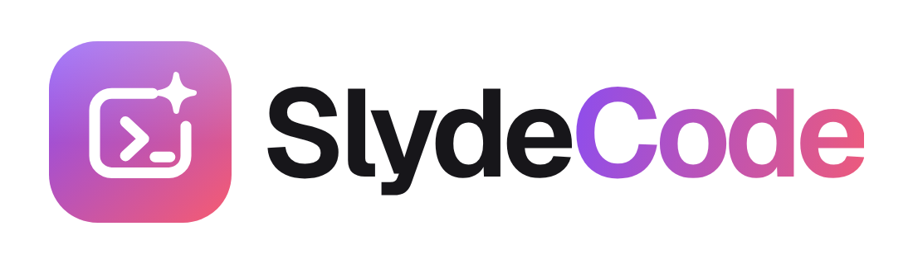

<p align="center">
  <picture>
    <source media="(prefers-color-scheme: dark)" srcset="assets/brand/slydecode-logo-dark.png">
    
  </picture>
</p>

<p align="center">
  <strong>Canva met a compiler.</strong> An AI-native, editorial-grade presentation studio.<br>
  <em>The high-performance Rust core owns the live deck state and compiles to zero-leak sandboxed HTML slides.</em>
</p>

<p align="center">
  
  
  
  
</p>

---

## Highlights

- **Linear/Figma-tier Studio UI:**
  - **Official Branding:** Clean vector brand identity and high-res transparent emblem.
  - **Deck Quick Tools:** Dedicated topbar tools to create a *New* presentation, *Open* an existing `.slyde` file from disk, and *Save* a copy instantly.
  - **Native Drag-and-Drop Storyboard:** Reorder slides effortlessly with smooth HTML5 drag-and-drop and spatial drop indicators.
  - **Slide Quick Actions:** Duplicate, delete, and shift slides up or down directly from thumbnail hover bars.
  - **Template Picker Popover:** One-click insertion of layout starters: *Hero*, *Bullet List*, *Diagram*, *Data Chart*, *Image Layout*, or *Code Block*.
  - **Subtabbed Inspector (Slide vs. Deck):** Clean separation of slide-specific settings (notes, animation, developer mode) from deck settings (visual theme swatches, ratio, exports) without vertical scroll fatigue.
  - **Visual Theme Swatches:** Instant palette switching (*Studio*, *Paper*, *Night*) with color dot previews.
  - **Canvas Zoom Controls:** Fit to viewport, 50%, 75%, 100%, 125%, 150%.
  - **Real-Time Save Status:** Continuous debounced autosave with a subtle pulsing status indicator.
  - **Dual-Locale Runtime i18n:** Full English and Spanish localization with zero-reload switching (`EN` / `ES`).
  - **Light & Dark Mode:** Warm minimalism with signature violet→coral gradients and AA-contrast compliant typography.

- **In-App AI Copilot with Live Reasoning Streaming:**
  - **8 Authentic Provider Logos:** DeepSeek, OpenAI (ChatGPT), Anthropic (Claude), Google Gemini, xAI (Grok), Groq, OpenRouter, and NVIDIA NIM with official SVG brand marks.
  - **Sub-300ms Live Thinking Stream (`ChatEvent::Thinking`):** Reasoning models like `deepseek-flash` stream their internal thinking process live in a downward collapsible mono drawer with markdown previews.
  - **Direct Upstream Error Transparency:** Never masks errors behind generic alerts; surfaces exact provider feedback and details.
  - **Full Deck Tools Loop:** The copilot autonomously inspects and modifies the deck using structured tools (`read_deck`, `read_slide`, `create_presentation`, `upsert_slide`, `remove_slide`, `move_slide`, `trigger_animation`, `set_notes`, `set_theme`, `set_title`).
  - **Contextual Prompt Suggestions:** Instant suggestion pills tailored to the active slide or deck state.
  - **Multimodal File Attachments:** Attach images (PNG, JPEG, WebP), PDFs, DOCX, PPTX, or code/text files with server-side extraction.
  - **Zero-Friction Key Management:** Keys stay on your machine, in the Windows Credential Manager or the macOS Keychain (an owner-only file on Linux), or in environment variables, and are never exposed to the browser.

- **Native Motion & Animation Engine:**
  - **Continuous CSS Motion Graphics:** Copilot writes hardware-accelerated CSS `@keyframes` in `<style>` for living graphics (rotating rings, pulsing glowing nodes, radar sweeps, SVG stroke drawings).
  - **Stepped Runtime Entrance Animations:** Built-in keyframes for `fade_up`, `fade`, `scale_in`, `slide_in_left`, `slide_in_right`, `typewriter`, `spin`, `rotate_in`, `pulse`, `flip_up`, `blur_in`, and `bounce_in`.
  - **Zero-Leak Sandbox Isolation:** Slide styles and scripts run within isolated, CSP-hardened iframes (`connect-src 'none'`, `form-action 'none'`).

- **Dual-Screen Presenter & Speaker Console:**
  - **Split Presenter Group:** One-click launch into fullscreen presentation mode or dedicated **Speaker Console** (*Modo Orador*).
  - **Popup Blocker Resilient:** Graceful unblocked navigation fallback ensuring presentation windows launch reliably in Chrome app mode.
  - **Stage Stepper & Blackout Mode:** Press `Space`/`Enter` to step through animation fragments, `B`/`.` for instant blank/blackout screen, `Home`/`End` to jump directly to first/last slide.
  - **Speaker Notes & Clocks:** Real-time wall clock, digital stopwatch timer (Play/Pause/Reset), and scalable notes viewer (`A-` / `A+`).

- **Model Context Protocol (MCP) Server:**
  - Connect external AI coding agents (Claude Desktop, Cursor, Windsurf, etc.) via stdio JSON-RPC 2.0 (`slyde mcp`).
  - Auto-spawns the studio instance if not already running.
  - External agent edits trigger visual scanline sweeps and live activity chips in the studio canvas.

- **High-Fidelity Chrome CLI & In-App Exports:**
  - Vector PDF exports (`--print-to-pdf`) formatted to exact 16:9 (`960×540 pt`).
  - High-res 1280×720 PNG slide images bundled into a clean ZIP download.
  - Bundled variable Geist Sans and Geist Mono typography embedded into exported artifacts.

---

## Platform support

| Platform | Status |
|---|---|
| Windows (x86_64-pc-windows-gnu) | Verified: full test suite, studio E2E, exports |
| Windows (x86_64-pc-windows-msvc) | Not verified on the development machine (no C++ build tools; `scripts/cargo.ps1` falls back to GNU there) |
| Linux | Pure crates compile for `x86_64-unknown-linux-gnu`; CI runs the Rust suite on ubuntu-latest. No manual pass yet |
| macOS | Pure crates compile for `x86_64-apple-darwin`; no manual pass yet |

`slyde-server` cannot be cross-*built* from Windows because `reqwest`/rustls pulls
`ring`, whose build script needs a C toolchain for the target. That is why the
Linux/macOS check in CI matters.

## Requirements

- **Rust:** Stable toolchain (`+stable-x86_64-pc-windows-gnu` recommended on Windows).
- **Browser:** Google Chrome, Chromium, or Microsoft Edge (Chromium-based).
- **Node.js:** Node.js 24+ for running the browser CDP test suite (zero npm dependencies).

---

## Build & Run

### 1. Build the Rust workspace
```powershell
cargo +stable-x86_64-pc-windows-gnu build --workspace
```

### 2. Start the Studio
```powershell
target\debug\slyde.exe app
```
The studio will automatically open in an isolated Google Chrome application window.

---

## Commands Reference

| Command | Purpose |
|---|---|
| `slyde` or `slyde app` | Launch the presentation studio and open Chrome. |
| `slyde app --present` | Launch directly in kiosk presenter mode. |
| `slyde app --no-open` | Start the local server without launching Chrome (prints session URL). |
| `slyde mcp` | Start the stdio MCP server for external agent integration. |
| `slyde export --format pdf --out deck.pdf` | Render and export the active deck as an exact 16:9 PDF. |
| `slyde export --format png --out exports/` | Export each slide as a PNG (2560×1440, one Chrome session). |
| `slyde export --format pptx --out deck.pptx` | Export a PowerPoint file: a clean picture of each slide with its text as editable text boxes on top, plus the speaker notes. |
| `slyde version` | Show version information. |
| `slyde help` | Show command usage. |

---

## Keyboard Shortcuts

| Shortcut | Context | Action |
|---|---|---|
| `ArrowRight` / `ArrowDown` | Studio / Presenter | Next slide |
| `ArrowLeft` / `ArrowUp` | Studio / Presenter | Previous slide |
| `Space` / `Enter` | Presenter | Advance animation step or next slide |
| `B` / `.` | Presenter | Blank / Blackout screen toggle |
| `Home` / `End` | Presenter | Jump directly to first or last slide |
| `S` | Presenter | Toggle Speaker Console Mode (*Modo Orador*) |
| `F` | Presenter | Toggle fullscreen |
| `Escape` | Presenter | Exit kiosk / presenter mode |
| `Ctrl+Z` / `Cmd+Z` | Studio | Undo mutation |
| `Ctrl+Y` / `Cmd+Shift+Z` | Studio | Redo mutation |
| `Drag & Drop` | Storyboard | Reorder slides with visual drop targets |

---

## Environment Variables

| Variable | Description |
|---|---|
| `SLYDE_DATA_DIR` | Custom directory for runtime metadata, decks, Chrome profiles, and copilot keys. |
| `SLYDE_UI_DIR` | Override the directory serving static web UI assets. |
| `SLYDE_ASSETS_DIR` | Override directory for bundled fonts and icons. |
| `SLYDE_BROWSER` | Explicit path to the Google Chrome, Chromium, or Edge executable. |
| `RUST_LOG` | Tracing filter configuration (logs output to stderr; stdout reserved for MCP). |

### Provider API Keys
Keys can be configured interactively in the studio Copilot sheet or supplied via environment variables:
`DEEPSEEK_API_KEY`, `OPENAI_API_KEY`, `ANTHROPIC_API_KEY`, `GEMINI_API_KEY` (or `GOOGLE_API_KEY`), `XAI_API_KEY`, `GROQ_API_KEY`, `OPENROUTER_API_KEY`, `NVIDIA_API_KEY`.

---

## Workspace Architecture

```
SlydeCode/
├── crates/
│   ├── slyde-core/      # Deck data models, validation limits, state manager, undo/redo, .slyde storage
│   ├── slyde-server/    # Loopback HTTP/WS server, Chrome lifecycle, MCP bridge, and Copilot engine
│   │   └── src/copilot/ # 8 LLM provider transports, reasoning streaming, attachments, tools loop
│   ├── slyde-export/    # Headless Chrome CLI export engine for PDF and PNG ZIP bundles
│   ├── slyde-mcp/       # Hand-rolled JSON-RPC 2.0 stdio loop and MCP tools schema
│   └── slyde-app/       # CLI entry points, subcommands, runtime rendezvous, and signal handling
├── ui/                  # Native vanilla ES modules UI (HTML5, CSS3, Geist variable fonts, zero bundler)
├── assets/fonts/        # Pre-packaged Geist Sans & Geist Mono woff2 fonts
├── docs/                # Architecture specifications, Copilot design, and Design System docs
└── tests/               # Browser CDP integration suite and activity state-machine tests
```

---

## Decks, images and exports

- **Deck library.** Every deck is a file under the app-data directory; the topbar
  **Library** sheet lists them with search, rename, duplicate and delete. Starting
  a deck no longer replaces the one you had open.
- **Images.** Paste (Ctrl+V) or drop an image onto the canvas, or use the
  inspector **Image** button. Drag to move, Shift+drag to resize, arrows to nudge.
  Images live in an asset store and travel with the deck: a `.slyde` file becomes
  a ZIP bundle (`deck.json` + `assets/`) as soon as a slide uses one.
- **Exports.** PDF (exact 16:9), PNG (2560×1440, one Chrome session for the whole
  deck, 1x or 2x from the inspector) and PPTX (the slide as a picture without its text,
  with that text as real, editable text boxes on top; notes preserved).
- **Copilot memory.** The conversation is stored per deck and comes back after a
  reload or a deck switch; "New chat" clears it.

---

## Running Tests

```powershell
# Rust: 161 unit and integration tests across the five crates
cargo test --workspace

# UI: 55 tests. Browser flows drive the real studio in headless Chrome over CDP;
# the component and i18n suites run the DOM-free modules directly in Node.
# No npm packages are involved.
cargo build --workspace
node --test "tests/ui/*.test.mjs"
```

The UI suite runs the newest `slyde` binary it finds under `target/` (`SLYDE_BIN`
overrides it), so build before running it.

### Quality gate

`cargo fmt --all --check` and `cargo clippy --workspace --all-targets -D warnings`
are both enforced in CI, together with the two suites above. Run them locally
before pushing:

```powershell
cargo fmt --all --check
cargo clippy --workspace --all-targets -- -D warnings
cargo test --workspace
node --test "tests/ui/*.test.mjs"
```

---

## Security model

- Both servers bind `127.0.0.1` only. The editor and the slide documents are
  served from **different origins**, and slides run in a `sandbox="allow-scripts"`
  iframe with a `connect-src 'none'` CSP, so AI-authored slide code cannot read
  the editor, its storage or the network.
- Two secrets exist, and they are not interchangeable:
  - the **session token** authorizes `/api/*` and the WebSocket. It is handed to
    the browser once in the launch URL, kept in `sessionStorage`, and sent as
    `Authorization: Bearer` (only navigations that cannot set headers — the WS
    handshake and file downloads — still carry it in the query string);
  - the **sandbox token** authorizes slide documents (`/s/{id}`) only. It is
    embedded in every iframe URL, so a slide's own script can read it; it opens
    no deck API.
- Provider keys live in the OS credential store on Windows and macOS. Linux keeps
  them in the app-data directory (`copilot.json`, mode `0600`), as does any machine
  whose credential store refuses the write. Keys are never returned to the browser.

---

## Documentation

- [`AGENTS.md`](./AGENTS.md) — Engineering charter, core rules, and strict quality bar.
- [`MEMORY.md`](./MEMORY.md) — Durable architectural decisions, research logs, and gotchas.
- [`STATE.md`](./STATE.md) — Project status, implementation checklist, and active backlog.
- [`docs/design-system.md`](./docs/design-system.md) — Design tokens, typography, motion, and contrast standards.
- [`docs/copilot.md`](./docs/copilot.md) — Copilot protocol, reasoning streams, tool schemas, and security model.

---

## License

SlydeCode is released under the **MIT License**; see [`LICENSE`](./LICENSE). The
crates declare the same license through `license.workspace = true`.

Bundled third-party assets keep their own licenses (`assets/fonts` is SIL OFL
1.1, `assets/vendor` ships KaTeX/highlight.js/Mermaid licenses next to the
bundles).

