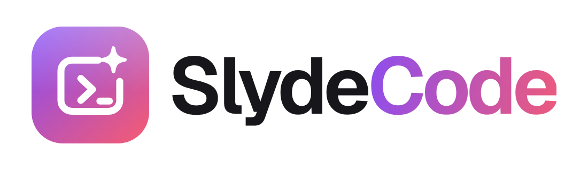

<p align="center">
  <picture>
    <source media="(prefers-color-scheme: dark)" srcset="assets/brand/slydecode-logo-dark.png">
    
  </picture>
</p>

<p align="center">
  <strong>SaC: Slide as Code.</strong><br>
  An AI-native presentation studio where every slide is real HTML/CSS, edited by AI and rendered by your own Chrome.<br>
  <em>Describe the deck. The copilot writes the slides, adds motion, generates or finds images, and keeps everything local.</em>
</p>

<p align="center">
  
  
  
  
</p>

---

## What is SaC?

**SaC (Slide as Code)** means a presentation is not a stack of fixed shapes inside a proprietary editor. It is a small, editable codebase: one HTML/CSS document per slide, a shared theme, notes and animation steps.

You write what you want in plain language. The copilot edits the real deck through tools, the Rust core validates every change, and Chrome renders the result in a sandboxed stage. You can inspect the code, edit it by hand, undo the AI's work in one step, or take the deck to PDF, PNG or PowerPoint.

The product is local-first by design: the studio runs on `127.0.0.1`, API keys never reach the browser, and generated images are stored inside the deck so it keeps working offline.

---

## Why it feels different

- **Real slides, not screenshots.** Every slide is live HTML and CSS, so typography, gradients, SVG and motion are real design decisions, not pictures of a canvas.
- **AI that works while you keep writing.** Image generation runs in the background. The text model can request several pictures, keep writing slides and let the image service place each result later.
- **Editorial quality by default.** The built-in prompt asks for one strong idea per slide, a clear focal point, a deliberate grid, readable contrast and restrained color.
- **Local and private.** Provider keys stay in the OS credential store (or an owner-only file), and slides run in a separate sandboxed origin with no network access.
- **No lock-in.** Export to PDF, PNG or PPTX; reopen the same deck as a `.slyde` file; connect external agents through MCP.

---

## Highlights

### Studio

- **Linear/Figma-tier editing surface:** storyboard, canvas, inspector and copilot in one workspace.
- **Deck quick tools:** create a new deck, open a `.slyde` file, save a copy, export or present.
- **Drag-and-drop storyboard:** reorder slides with visual drop targets.
- **Slide actions:** duplicate, delete and move slides from the thumbnail bar.
- **Template picker:** start from Hero, Bullet List, Diagram, Data Chart, Image Layout or Code Block.
- **Subtabbed inspector:** separate slide settings (notes, animation, developer mode) from deck settings (theme, ratio, exports).
- **Visual themes:** Studio, Paper and Night, plus custom palettes designed by the copilot.
- **Canvas zoom:** fit, 50%, 75%, 100%, 125% and 150%.
- **Autosave with visible status:** every change is saved and the studio tells you when.
- **Light and dark mode:** warm minimalism with the violet-to-coral signature and AA-contrast typography.
- **English and Spanish:** switch language at runtime without reloading.

### Copilot

- **Eight providers:** DeepSeek, OpenAI (ChatGPT), Anthropic (Claude), Google Gemini, xAI (Grok), Groq, OpenRouter and NVIDIA NIM, with official brand marks.
- **Live reasoning:** models that expose thinking tokens stream them into a collapsible drawer.
- **Tool-driven deck editing:** `read_deck`, `read_slide`, `create_presentation`, `build_deck`, `write_slides`, `upsert_slide`, `remove_slide`, `move_slide`, `trigger_animation`, `set_notes`, `set_theme`, `set_title`, `mutate_element`, `insert_image`, `request_image` and `search_images`.
- **One batch call for a whole deck:** `build_deck` and `write_slides` reduce token cost and latency.
- **One layout review, not a rewrite loop:** after full-slide writes, a real browser checks for hard failures such as overflow, clipping and overlaps. Cosmetic warnings do not trigger a whole-deck rewrite.
- **Server-side cancellation:** Stop aborts the provider call and any queue of tool work, not just the browser stream.
- **Actionable errors:** stable error codes and localized messages, with an optional provider report for diagnosis.
- **Contextual suggestions:** quick prompts based on the selected slide and current deck.
- **Multimodal attachments:** images, PDFs, DOCX, PPTX and text/code files are read on the server and passed to the model as context.

### Images and visual content

- **Pictures that survive the deck:** `insert_image` stores linked, pasted or generated bytes in the asset store, so slides work offline and travel inside a `.slyde` bundle.
- **Background generation:** `request_image` returns a ticket immediately. The image service chooses the configured model, generates while the copilot keeps writing, and buffers the result until its target slide exists.
- **Images on the copilot's judgment:** it decides when a slide benefits from a picture—covers, products, places, people, mood and concept slides—without waiting for an explicit request. It aims for a cover and one or two key visual moments, not an image on every slide.
- **Image source switch:** the small chip beside the model chooses **Off**, **AI images** or **Stock images**. The choice is saved and changes what the copilot is allowed to use.
- **Retry failed pictures:** a failed image row gets a Retry button that re-queues the same prompt and target without asking the model again.
- **No quantity guessing in the prompt:** the text model is simply told that an image model is available. It does not receive a predicted image count, balance or price. The service still enforces a hard 10-image-per-turn ceiling, a 10-images-per-minute rate and at most 3 parallel generations.
- **Independent image model:** choose a chat model and an image model separately. For example, DeepSeek can write the deck while OpenAI or Gemini draws.
- **OpenRouter image catalog:** the image picker reads OpenRouter's dedicated `/api/v1/images/models` catalog and supports its routed image models.
- **Cancellation is complete:** stopping the text turn also cancels queued and in-flight image jobs for that turn.
- **Stock fallback:** when no image generator is usable and at least one stock key is configured, `search_images` finds photos on Unsplash and Pexels and vectors on Vecteezy, then places the chosen result with `insert_image`.
- **Stock keys in the app:** open **Provider & model → Stock image keys** to save Unsplash, Pexels or Vecteezy credentials without touching a terminal. The same keys can come from environment variables.
- **Model fit:** the image service waits for the target slide (up to 120 seconds) and for the text turn to finish rewriting slides, so a later edit cannot erase the picture. Images are inserted above the slide content with their own layer.

### Motion and presentation

- **Continuous CSS motion:** the copilot can write hardware-accelerated `@keyframes` for rings, glows, radar sweeps and SVG drawing effects.
- **Stepped animations:** `fade_up`, `fade`, `scale_in`, `slide_in_left`, `slide_in_right`, `typewriter`, `spin`, `rotate_in`, `pulse`, `flip_up`, `blur_in` and `bounce_in`.
- **Dual-screen presenter:** launch fullscreen presentation mode or a dedicated Speaker Console.
- **Speaker console:** wall clock, timer, scalable notes and the next-slide preview.
- **Presenter controls:** Space/Enter to advance animation steps, B or `.` to black out, Home/End to jump, S for the speaker console, F for fullscreen and Escape to exit.
- **Popup-blocker resilient:** falls back gracefully when Chrome blocks a new window.

### MCP and integrations

- **MCP server over stdio:** connect Claude Desktop, Cursor, Windsurf or another MCP client with `slyde mcp`.
- **Reuses the running studio:** MCP auto-spawns the app if no healthy instance exists.
- **Same mutation path:** human edits, copilot edits and external agents all go through the same validated deck commands, undo/redo and autosave.
- **Live activity:** external edits trigger the scanline sweep and activity chip in the studio, so the user can see what the agent is doing.

### Exports

- **PDF:** vector output at exact 16:9 (`960×540 pt`).
- **PNG:** 2560×1440 per slide by default, one Chrome session for the whole deck, bundled into a ZIP.
- **PowerPoint:** a clean picture of each slide with the text recovered as editable text boxes, plus speaker notes.
- **Bundled fonts:** Geist Sans and Geist Mono are embedded in exported artifacts.

---

## Quick start

### Requirements

- **Rust:** stable toolchain. On Windows, `+stable-x86_64-pc-windows-gnu` is the verified target.
- **Browser:** Google Chrome, Chromium or Microsoft Edge (Chromium-based).
- **Node.js 22+** only if you want to run the browser test suite (no npm packages required).

### Build

```powershell
cargo +stable-x86_64-pc-windows-gnu build --workspace
```

### Run the studio

```powershell
target\debug\slydecode.exe
```

This opens the studio in an isolated Chrome app window. `slydecode.exe` has no console window and stops a few seconds after the last window closes. Its log is `slydecode.log` in `%APPDATA%\SlydeCode`.

For a console build that stays up until `Ctrl+C`:

```powershell
target\debug\slyde.exe app
```

To start only the local server and print its session URL:

```powershell
target\debug\slyde.exe app --no-open
```

### First run

There is no SlydeCode account or cloud workspace: decks live on your machine. A provider key is only needed for the AI copilot.

1. Open **Provider & model** from the copilot panel.
2. Pick a provider and paste its API key. The key is validated before it is saved.
3. Choose a chat model and an image source: **Off**, **AI images** or **Stock images**. The image model itself is chosen separately in the provider sheet.
4. Describe the deck you want. For example: *“Make a 7-slide launch deck for a coffee brand, editorial and warm, with one photo on the cover.”*
5. Review the slides as they appear. The copilot runs one real-browser layout check and fixes hard failures such as off-canvas text, clipping or overlaps before finishing.

---

## Commands

| Command | Purpose |
|---|---|
| `slyde` or `slyde app` | Launch the studio and open Chrome. Stays up until `Ctrl+C`. |
| `slydecode` | Same, without a console window. Stops when the last window closes. |
| `slyde app --present` | Launch directly in kiosk presenter mode. |
| `slyde app --no-open` | Start the local server without opening Chrome and print the session URL. |
| `slyde mcp` | Start the stdio MCP server for external AI agents. |
| `slyde export --format pdf --out deck.pdf` | Export the active deck as an exact 16:9 PDF. |
| `slyde export --format png --out exports/` | Export each slide as a PNG (2560×1440, one Chrome session). |
| `slyde export --format pptx --out deck.pptx` | Export a PowerPoint file with editable text boxes and speaker notes. |
| `slyde version` | Show version information. |
| `slyde help` | Show command usage. |

---

## Keyboard shortcuts

| Shortcut | Context | Action |
|---|---|---|
| `ArrowRight` / `ArrowDown` | Studio / Presenter | Next slide |
| `ArrowLeft` / `ArrowUp` | Studio / Presenter | Previous slide |
| `Space` / `Enter` | Presenter | Advance one animation step or go to the next slide |
| `B` / `.` | Presenter | Blank / blackout screen |
| `Home` / `End` | Presenter | Jump to the first or last slide |
| `S` | Presenter | Toggle Speaker Console |
| `F` | Presenter | Toggle fullscreen |
| `Escape` | Presenter | Exit kiosk / presenter mode |
| `Ctrl+Z` / `Cmd+Z` | Studio | Undo |
| `Ctrl+Y` / `Cmd+Shift+Z` | Studio | Redo |
| Drag and drop | Storyboard | Reorder slides |

---

## Configuring AI providers

Provider keys can be configured from the copilot sheet or supplied through environment variables:

```text
DEEPSEEK_API_KEY
OPENAI_API_KEY
ANTHROPIC_API_KEY
GEMINI_API_KEY (or GOOGLE_API_KEY)
XAI_API_KEY
GROQ_API_KEY
OPENROUTER_API_KEY
NVIDIA_API_KEY
```

### Stock image keys

The stock fallback is optional. Configure it in **Provider & model → Stock image keys**:

- **Unsplash:** access key
- **Pexels:** API key
- **Vecteezy:** API key and account ID

Keys are stored the same way as provider keys: OS credential store where available, an owner-only file otherwise. Environment variables remain a fallback:

```text
UNSPLASH_ACCESS_KEY
PEXELS_API_KEY
VECTEEZY_API_KEY
VECTEEZY_ACCOUNT_ID
```

If no image generator and no stock service are configured, the copilot still works; it simply uses `insert_image` with a URL you provide.

---

## Environment variables

| Variable | Description |
|---|---|
| `SLYDE_DATA_DIR` | Custom directory for decks, metadata, Chrome profiles and copilot keys. |
| `SLYDE_UI_DIR` | Override the static web UI directory. |
| `SLYDE_ASSETS_DIR` | Override the fonts and icons directory. |
| `SLYDE_BROWSER` | Explicit path to Chrome, Chromium or Edge. |
| `RUST_LOG` | Tracing filter (stderr; stdout is reserved for MCP). |

---

## How the image system works

This is the part that most distinguishes SaC from a simple “generate image” button.

1. The copilot asks for a picture with a unique `image_id`, a visual prompt, alt text and a target slide. It does not choose the provider or model.
2. The image service checks whether a configured model is usable and returns a ticket immediately.
3. A background worker generates the picture, respecting the rate limit and the parallel worker limit.
4. If the target slide does not exist yet, the job waits instead of failing or guessing another slide.
5. The finished image is saved in the deck's asset store and inserted at the requested position.
6. If generation fails, the image block disappears from the next prompt for 90 seconds and the chat shows a localized error. A user cancellation is not treated as an error.

The prompt only advertises availability; it does not predict how many images the account can afford. The hard per-turn cap and the internal spend guard remain hidden safety limits.

---

## Workspace architecture

```text
SlydeCode/
├── crates/
│   ├── slyde-core/      # Deck model, validation, state, undo/redo and .slyde storage
│   ├── slyde-server/    # Loopback HTTP/WS server, Chrome lifecycle, MCP bridge and copilot
│   │   └── src/copilot/ # Transports, reasoning, attachments, tools, images, stock search
│   ├── slyde-export/    # Chrome/CDP export engine: PDF, PNG, slide audit and HTML
│   ├── slyde-pptx/      # OOXML writer: one picture per slide plus editable text boxes
│   ├── slyde-mcp/       # JSON-RPC 2.0 stdio loop and MCP tool schema
│   └── slyde-app/       # CLI entry points, subcommands, rendezvous and signals
├── ui/                  # Vanilla ES modules, HTML and CSS; no bundler
├── assets/              # Brand, fonts, icons and templates
├── docs/                # Architecture, copilot and design-system references
└── tests/               # Browser CDP integration and component suites
```

---

## Testing and quality

```powershell
# Rust: 353 tests across the workspace (352 passing, 1 ignored: it writes to the real credential store)
cargo +stable-x86_64-pc-windows-gnu test --workspace

# UI: 112 tests in 12 files. Browser flows use headless Chrome over CDP;
# component, i18n and module suites run directly in Node. No npm packages.
cargo +stable-x86_64-pc-windows-gnu build --workspace
node --test "tests/ui/*.test.mjs"
```

The UI suite runs the newest `slyde` binary it finds under `target/`; `SLYDE_BIN` overrides it.

### Quality gate

CI enforces:

```powershell
cargo fmt --all --check
cargo clippy --workspace --all-targets -- -D warnings
cargo test --workspace
node --test "tests/ui/*.test.mjs"
```

---

## Security and privacy

- **Loopback only.** The studio and the slide sandbox bind `127.0.0.1`.
- **Two separate tokens.**
  - The **session token** authorizes `/api/*` and the WebSocket. It is handed to the browser once in the launch URL, kept in `sessionStorage`, and sent as `Authorization: Bearer`. Navigations that cannot set headers (the WebSocket handshake and downloads) still carry it in the query string.
  - The **sandbox token** authorizes slide documents (`/s/{id}`) only. It is embedded in iframe URLs, so a slide can read it, but it opens no deck API.
- **Sandboxed slides.** AI-authored code runs in a cross-origin `sandbox="allow-scripts"` iframe with `connect-src 'none'` and `form-action 'none'`. A slide cannot read the editor, its storage or the network.
- **Keys never reach the browser.** They live in Windows Credential Manager, macOS Keychain, or an owner-only config file. A custom `SLYDE_DATA_DIR` keeps its own isolated store.
- **Images are stored, not hotlinked.** Remote pictures are downloaded through an SSRF-safe fetcher and saved into the deck, so exports and offline viewing stay deterministic.

---

## Platform support

| Platform | Status |
|---|---|
| Windows (`x86_64-pc-windows-gnu`) | Verified: full Rust suite, studio E2E and exports |
| Windows (`x86_64-pc-windows-msvc`) | Not verified on the development machine (no C++ build tools; use the GNU target) |
| Linux | Pure crates compile for `x86_64-unknown-linux-gnu`; CI runs the Rust suite on Ubuntu. No manual pass yet |
| macOS | Pure crates compile for `x86_64-apple-darwin`; no manual pass yet |

`slyde-server` cannot be cross-built from Windows because `reqwest`/rustls pulls `ring`, whose build script needs a C toolchain for the target. That is why the Linux and macOS CI checks matter.

---

## Documentation

- [`AGENTS.md`](./AGENTS.md) — Engineering charter, rules and quality bar.
- [`MEMORY.md`](./MEMORY.md) — Durable architectural decisions and gotchas.
- [`STATE.md`](./STATE.md) — Current project state and backlog.
- [`docs/copilot.md`](./docs/copilot.md) — Copilot protocol, tools, image service and security model.
- [`docs/design-system.md`](./docs/design-system.md) — Tokens, typography, motion and contrast standards.

---

## License

SlydeCode is released under the **MIT License**; see [`LICENSE`](./LICENSE). The crates declare the same license through `license.workspace = true`.

Bundled third-party assets keep their own licenses: `assets/fonts` is SIL OFL 1.1, and `assets/vendor` ships KaTeX/highlight.js/Mermaid licenses next to the bundles.
